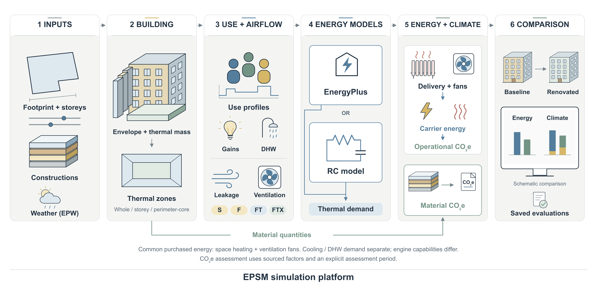

# EPSM

<!-- EPSM introduction: Pocket CAD -->
<picture>
  <source media="(prefers-color-scheme: dark)" srcset="docs/assets/welcome/epsm-dark.png">
  
</picture>

Welcome to EPSM, a research platform for exploring buildings and renovation
choices. Build a physical model, choose an energy engine and compare energy use
and climate impact through one Python interface. Each evaluation keeps its
inputs, assumptions and results available for inspection.

**[Explore the EPSM platform →](docs/platform.md)**
<!-- /EPSM introduction -->

[](https://github.com/SB-Chalmers/epsm/actions/workflows/ci.yml) [](https://github.com/SB-Chalmers/epsm/releases) [](https://github.com/SB-Chalmers/epsm/issues)

## From building inputs to renovation choices



Follow one building from its inputs to an energy and climate comparison.
The figure is conceptual; comparison bars are schematic. See the
[platform guide](docs/platform.md) for package roles, the construction data model
and each engine's scope.

<a id="install-and-examples"></a>

## Getting started

Requires Python 3.11+, Git and access to the EPSM dependency repositories.

```sh
git clone https://github.com/SB-Chalmers/epsm.git
cd epsm
python3 -m venv .venv
source .venv/bin/activate
python -m pip install --upgrade pip
python -m pip install \
  "epsm_data @ git+https://github.com/SB-Chalmers/epsm_data.git@main" \
  "epsm_core @ git+https://github.com/SB-Chalmers/epsm_core.git@main" \
  "epsm_lca @ git+https://github.com/SB-Chalmers/epsm_lca.git@main" \
  "epsm_rc @ git+https://github.com/SB-Chalmers/epsm_rc.git@main" \
  -e '.[rc,examples]'
```

```python
from epsm import Building

building = Building(preset="illustrative-reference")
print(building)
```

The preset supplies teaching assumptions. Start with the worked notebooks to
provide your own building inputs and EPW weather, then run RC energy and climate
comparisons. EnergyPlus simulations need a separate EnergyPlus installation.

## Documentation

- [Detailed guide and shared development environment](docs/guide.md)
- [Worked notebooks](examples/README.md)
- [Platform and package overview](docs/platform.md)
- [Compatibility and verification](docs/platform-compatibility.md)
- [Release notes](RELEASE_NOTES.md)

<details>
<summary>Tested package combination</summary>

### Tested package combination

[compatibility.json](compatibility.json) records the reviewed versions and exact
commits. See the [detailed guide](docs/guide.md#tested-package-combination) for scope.

<!-- compatibility-table:start -->
| Package | Version | Tested commit |
| --- | --- | --- |
| `epsm` | 0.6.0 | `self` |
| `epsm_core` | 0.10.0 | `8a260726e354b049e7459aeb7c167aeca4e6ef5d` |
| `epsm_data` | 0.7.0 | `7fb68171e95ef32b59872e5d01bfc85b04aea56b` |
| `epsm_db` | 0.5.0 | `a3dcdb76a8505826b10492189da4b0ea74f7aeb5` |
| `epsm_lca` | 0.4.0 | `62e78df8cca8e11a3bb87effb6501ab055867fe0` |
| `epsm_rc` | 0.11.0 | `dcb47ba9e8a5ce8919e84017822d7f2d7e55af00` |
| `epsm_studies` | 0.5.0 | `6bccba1a5195002beeb23573172ae3ccedc6368b` |
| `epsm_viewer` | 0.1.0 | `f2c847b9cd44280b7cf21803acfefa6e49e78b1b` |
| `epsm_workflows` | 0.6.0 | `05379096963ba9809008e41ea3aaedb00f487211` |
| `smhi2epw` | 1.3.0 | `6792b2a4d1bc6a7bdcd1bd77b35dd0ff704f2b29` |
<!-- compatibility-table:end -->

</details>

## License

[MIT](LICENSE).

## People and support

Developed at Chalmers University of Technology as part of the EPSM research platform.

**Funding**: Swedish Energy Agency (Project ID: P2024-04053)

**Partners**:

- Lindholmen Science Park AB
- Sinom AB
- Stiftelsen Chalmers Industriteknik

**Team**:

- **Lead Developer**: Sanjay Somanath
- **Principal Investigator**: Alexander Hollberg
- **Contributors**: Yinan Yu, Dag Wästberg

<p align="center">
  
</p>
