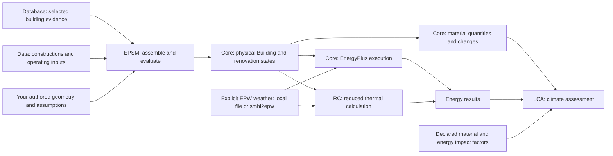

# The EPSM platform

<picture>
  <source media="(prefers-color-scheme: dark)" srcset="assets/brand/epsm-dark.png">
  
</picture>

EPSM brings building evidence, physical models, energy simulation and climate
assessment into one research workflow. Use the Python libraries for a single
building or a repeatable experiment, and the web application to work visually.
Each package has one job and keeps the inputs, assumptions and results available
for inspection.

## Choose where to start

| What you want to do | Start here |
| --- | --- |
| Try a complete building and renovation example | [EPSM worked notebooks](../examples/README.md) and [installation](../README.md#install-and-examples) |
| Author or inspect a physical building | [Core building guide](https://github.com/SB-Chalmers/epsm_core/blob/main/docs/physical-building.md) and [geometry lessons](https://github.com/SB-Chalmers/epsm_core/blob/main/demo/README.md) |
| Find materials, constructions and operating assumptions | [Data catalogue](https://github.com/SB-Chalmers/epsm_data/blob/main/README.md) |
| Explore Swedish building evidence | [Database introduction](https://github.com/SB-Chalmers/epsm_db/blob/main/README.md) and [stock notebook](https://github.com/SB-Chalmers/epsm_db/blob/main/notebooks/explore_stock.ipynb) |
| Prepare a local or cluster experiment | [Reusable Workflows guide](https://github.com/SB-Chalmers/epsm_workflows/blob/main/docs/reusable-workflows.md) |
| Work in the web application | [Studio setup and rebuild status](https://github.com/SB-Chalmers/epsm_studio/blob/main/README.md) |
| Contribute or design an interface | [Developer handbook](https://github.com/SB-Chalmers/epsm_development/blob/main/README.md) and [Studio visual design manual](https://github.com/SB-Chalmers/epsm_studio/blob/main/docs/design/README.md) |

## Meet the packages

The Pocket CAD icons identify the same package in documentation and interfaces.
Their shared grid, room geometry and restrained red accent make them a family;
the symbol tells you which job a package owns. Names remain visible beside icons.

| Icon | Repository | What it helps you do |
| --- | --- | --- |
| <picture><source media="(prefers-color-scheme: dark)" srcset="assets/brand/epsm-dark.png"></picture> | [EPSM](https://github.com/SB-Chalmers/epsm) | Author a building, select an energy engine and inspect combined energy and climate results through one Python interface. |
| <picture><source media="(prefers-color-scheme: dark)" srcset="assets/brand/epsm_core-dark.png"></picture> | [Core](https://github.com/SB-Chalmers/epsm_core) | Create physical building geometry, quantities and renovation states; compile and run EnergyPlus. |
| <picture><source media="(prefers-color-scheme: dark)" srcset="assets/brand/epsm_data-dark.png"></picture> | [Data](https://github.com/SB-Chalmers/epsm_data) | Reuse and author materials, layered constructions, operating profiles, assessment factors and renovation measures. |
| <picture><source media="(prefers-color-scheme: dark)" srcset="assets/brand/epsm_db-dark.png"></picture> | [Database](https://github.com/SB-Chalmers/epsm_db) | Ingest, query and inspect Swedish building evidence with its sources, coverage and quality findings. |
| <picture><source media="(prefers-color-scheme: dark)" srcset="assets/brand/epsm_rc-dark.png"></picture> | [RC](https://github.com/SB-Chalmers/epsm_rc) | Calculate hourly thermal behaviour using an explicitly selected reduced model of the shared physical building. |
| <picture><source media="(prefers-color-scheme: dark)" srcset="assets/brand/epsm_lca-dark.png"></picture> | [LCA](https://github.com/SB-Chalmers/epsm_lca) | Assess material changes and supplied annual energy, and compare the climate impact of renovation steps. |
| <picture><source media="(prefers-color-scheme: dark)" srcset="assets/brand/epsm_workflows-dark.png"></picture> | [Workflows](https://github.com/SB-Chalmers/epsm_workflows) | Design experiments, explore renovation alternatives and execute prepared cases locally or through Slurm. |
| <picture><source media="(prefers-color-scheme: dark)" srcset="assets/brand/epsm_studies-dark.png"></picture> | [Studies](https://github.com/SB-Chalmers/epsm_studies) | Record research protocols, compare energy results and retain study evidence and historical archives. |
| <picture><source media="(prefers-color-scheme: dark)" srcset="assets/brand/smhi2epw-dark.png"></picture> | [smhi2epw](https://github.com/SB-Chalmers/smhi2epw) | Build complete-year EnergyPlus weather files from Swedish observations and inspect documented recovery steps. |
| <picture><source media="(prefers-color-scheme: dark)" srcset="assets/brand/epsm_viewer-dark.png"></picture> | [Viewer](https://github.com/SB-Chalmers/epsm_viewer) | Inspect supplied building scenes in a browser or Python notebook, with selection and camera controls. |
| <picture><source media="(prefers-color-scheme: dark)" srcset="assets/brand/epsm_studio-dark.png"></picture> | [Studio](https://github.com/SB-Chalmers/epsm_studio) | Work through application forms, projects, settings and requested jobs, with adapters to the scientific packages. |
| <picture><source media="(prefers-color-scheme: dark)" srcset="assets/brand/epsm_development-dark.png"></picture> | [Development](https://github.com/SB-Chalmers/epsm_development) | Find shared engineering guidance, writing conventions, worked examples and contribution templates. |

## How a calculation fits together

Start with a physical building. Its geometry may be authored directly or assembled
from selected evidence. Assign constructions and operating assumptions, provide
weather, then choose an energy engine. The same physical model can support an
EnergyPlus calculation or an explicitly reduced RC calculation. Their numerical
methods and supported assumptions differ.

Arrows show information passed during an evaluation; they are not an installation
dependency graph. Existing local weather and directly authored buildings work
without a database connection. Climate assessment can use explicitly supplied
annual energy without running an energy engine.

Workflows prepares and executes repeated evaluations, records attempts and
collects results. Studies records the research question and protocol and checks
comparisons. Viewer draws Core's portable scene data. Studio supplies the web
application and its adapters. The Development handbook explains how to maintain
these responsibilities; it is documentation rather than a runtime package.

## Keep the meaning clear

Source evidence describes what is known about a building. Catalogue selections,
procedural geometry and model reduction introduce assumptions. Keep both visible
and inspect missing information before running a study. The illustrative presets
in examples are teaching inputs, not measured building records.

Core owns physical geometry and quantities. Data owns reusable definitions and
sourced factors. RC and EnergyPlus own their respective energy calculations; LCA
owns the meaning of climate results. A completed run or a passing software check
does not establish prediction accuracy for measured buildings.

The repositories develop independently. Use the
[reviewed compatibility information](../README.md#tested-package-combination) when
installing coordinated packages, and read each package's prerequisites and
limitations. Some distributions require access to private EPSM repositories.

Studio's [frontend rebuild](https://github.com/SB-Chalmers/epsm_studio/tree/main)
now lives on `main`. The previous application's source remains in Git history.
The rebuild demonstrates workflows with illustrative authentication and
calculations; production services remain planned. Consult Studio's README for
its current scope and setup.
Viewer's README retains its current candidate status and documents private artifact
installation; consult its release documentation for publication evidence.
The [design manual](https://github.com/SB-Chalmers/epsm_studio/blob/main/docs/design/README.md)
defines the shared visual language without changing either application's
scientific behaviour.
